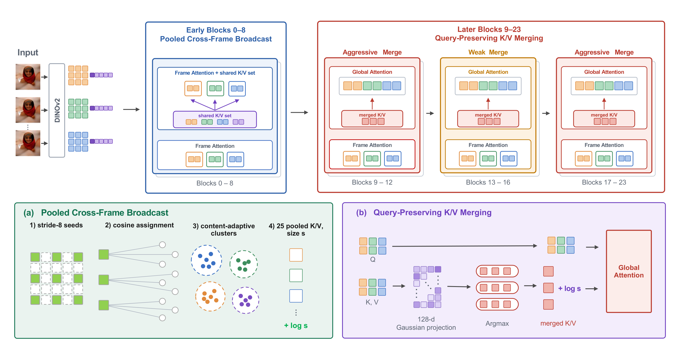

<p align="center">

  <h1 align="center">GPA-VGGT: Geometry-Preserving Acceleration of VGGT</h1>
  <h3 align="center">WACV 2027</h3>
  <p align="center">
    Muyeol Sung
    ·
    Jangwon Kim
    ·
    Jongwoo Lim
  </p>
  <p align="center">Seoul National University</p>

  <div align="center">
    <a href="https://noheat61.github.io/GPA-VGGT/"></a>
  </div>
</p>

<p align="center">
  <strong>TL;DR:</strong> <em>Training-free acceleration of VGGT that runs at speeds comparable to prior accelerators (2.58× at 200 frames) while keeping over 99% of VGGT's camera-pose accuracy under the strict AUC@3 metric.</em>
</p>
<br>

## Overview
<p align="center">
  
</p>

We propose GPA-VGGT, a training-free acceleration method that replaces global attention in early blocks with frame attention augmented by a shared cross-frame K/V set. In the remaining blocks, we merge only keys and values while preserving all queries, restore the attention mass of the tokens each merged key represents, and randomly project the matching metric to 128 dimensions to reduce matching cost. Across diverse multi-view geometry tasks, GPA-VGGT provides training-free acceleration at speedups comparable to prior work while preserving the information required for precise geometric estimation, retaining over 99% of VGGT's pose accuracy under AUC@3.

## Installation
### Environment Setup
Clone the repository and create a conda environment.
```bash
git clone https://github.com/noheat61/GPA-VGGT.git
cd GPA-VGGT
conda create -n gpavggt python=3.10 -y
conda activate gpavggt
pip install -r requirements.txt
```

The pinned environment is PyTorch 2.11 / CUDA 12.8 / Triton 3.6.

### Checkpoint
GPA-VGGT runs the released VGGT checkpoint unchanged.
```bash
mkdir -p ckpt
wget -P ckpt https://huggingface.co/facebook/VGGT_tracker_fixed/resolve/main/model_tracker_fixed_e20.pt
```

## Evaluation
The default model configuration of every script is GPA-VGGT as used in the paper; add `--vanilla` to run vanilla VGGT. Datasets are read from `dataset/` by default (e.g. `dataset/co3d/{DATA,ANNO}`); every script also takes an explicit path argument.

### Camera pose on CO3D
```bash
python eval/eval_co3d.py --fast_eval --num_frames 10 --seed 0 --deterministic
```

## License
This repository is released under the [VGGT License](./LICENSE.txt).

## Citation
```bibtex
@inproceedings{sung2027gpavggt,
  title     = {{GPA-VGGT}: Geometry-Preserving Acceleration of {VGGT}},
  author    = {Sung, Muyeol and Kim, Jangwon and Lim, Jongwoo},
  booktitle = {Proceedings of the IEEE/CVF Winter Conference on Applications of Computer Vision (WACV)},
  year      = {2027}
}
```
